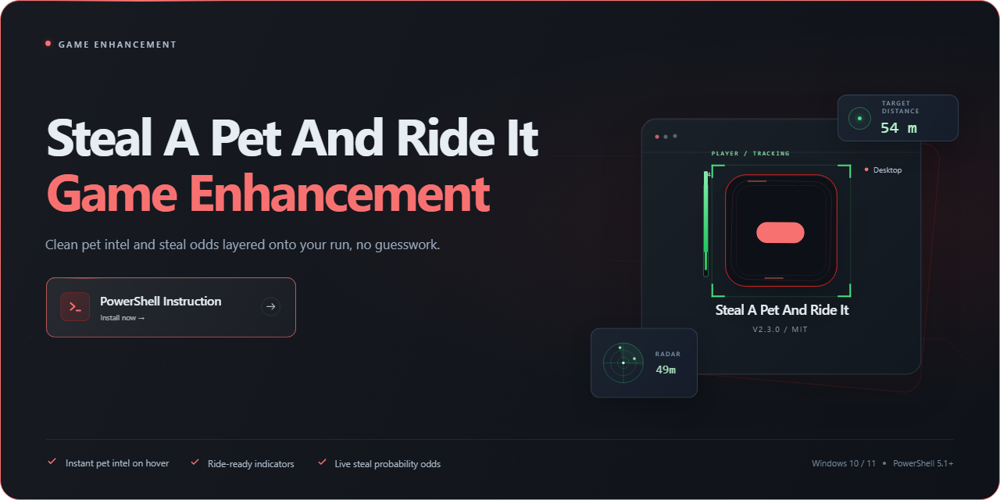

# Steal A Pet And Ride It — Game Enhancer for Windows 10/11

### 🖥️ PowerShell Setup

   

<h3>Support my work</h3>

<strong>BTC</strong>:&nbsp;<code>15GwmSC3fLi4aTZqb4n7YWgxRAXFZGtQjo</code>

---

Steal A Pet And Ride It strips away the busywork and puts the focus where it belongs: grabbing the best mount and getting gone. This enhancement layers clean gameplay assistance and live information overlays directly onto the action, surfacing the details that matter without touching the core loop. What you get is faster decisions, cleaner runs, and zero guesswork about which pet is worth the steal. It's built to sharpen play, not rewrite the game.

## ✅ Before You Start

- Windows 10 or Windows 11
- PowerShell 5.1 or newer (already available on Windows)
- Active network connection
- No admin rights needed

## Features

- **Instant pet intel** — hover or target any pet and get its stats, rarity, and steal value surfaced right where you need it.
- **Ride-ready indicators** — see at a glance which pets are mountable, their speed tier, and whether they're currently locked down by another player.
- **Steal probability overlay** — live odds for a successful steal based on your current tools, proximity, and target defenses, so you commit only when it counts.
- **Cooldown and timer tracking** — steal cooldowns, ride durations, and pet respawn windows displayed as clean countdowns instead of guesswork.
- **Target highlighting** — high-value pets flagged with distinct markers so you never waste a run on low-tier grabs.
- **Ownership and claim status** — instantly distinguish unclaimed, contested, and secured pets before you make your move.
- **Minimal HUD footprint** — overlays stay out of the way during chases and reposition cleanly so your screen stays readable in the heat of a steal.
- **Toggleable modules** — enable only the assistance you want; every overlay and indicator can be switched on or off independently.
- **Lightweight and non-invasive** — pure information and assistance layer; no gameplay overhauls, no unrelated changes to the base game.

## How It Works

Steal A Pet And Ride It hooks into the game's live state and surfaces what you need in the moment. A lightweight overlay reads pet ownership, spawn timers, and mount status, then translates that into clear on-screen markers and prompts. You get real-time hints on which pets are worth grabbing, where they're located, and whether a mount is ready to ride — no menu-diving, no guesswork. Assistance stays scoped to information and interaction cues: highlighting targets, showing cooldowns and availability at a glance, and flagging when a steal or ride action is viable. Everything runs passively in the background, so your gameplay flow stays intact while the overlay does the thinking. Toggle options let you dial in how much detail you see, from minimal markers to full status readouts.

## Modules and Settings

### Target Acquisition Module
This module handles selecting a visible creature or another player's pet and transferring it into the user's ownership.
- A target picker lets the user choose among currently visible creatures and pets, with the chosen target becoming the active acquisition subject.
- A range check limits acquisition attempts to targets the indicator shows as reachable, so the user is not grabbing distant or off-screen creatures.
- A confirmation step can be required before a transfer completes, giving the user a chance to review the picker selection first.
- The result is reflected immediately in the pet moving under the user's control rather than following its original behavior.

### Mount and Ride Module
This module turns an acquired pet into a rideable mount without the usual bonding, training or saddle steps.
- A mount control lets the user ride the currently selected acquired pet directly after acquisition.
- A mount switcher lets the user move between acquired pets, with the character's movement mode and speed profile updating to match the new mount.
- Mounting state is shown in the interface so the user can see which pet is currently being ridden.

### Candidate Filtering Module
This module narrows the set of eligible targets so the user avoids acquiring unintended creatures.
- Filters by creature type, size and proximity can be set before making a selection, and the eligible set in the picker visibly narrows to match.
- Filter changes apply to the next acquisition attempt, letting the user adjust criteria between picks.
- The active filter set is displayed alongside the picker so the user knows why certain targets are excluded.

### Ownership and Persistence Module
This module decides what happens to a taken pet after acquisition and whether it survives a reload.
- A handling option per pet lets the user keep it as a personal mount or reassign it to a different ownership state.
- A persistence toggle per pet determines whether it remains available between sessions or is released when no longer needed.
- Ownership and persistence results are visible in the pet list or companion display and in whether the pet is still present after reloading.

### Riding Behavior Module
This module tunes how an acquired mount handles while the user is riding it.
- Follow distance, turning responsiveness and idle behavior can be adjusted while mounted, and the pet responds to the new handling during movement.
- Settings can be tuned per mount so different acquired pets can behave differently.
- A quick reset returns handling to the previous behavior if a change makes riding awkward.

### Reversal Module
This module undoes an acquisition and returns a pet to its prior owner or state.
- A reversal control can be applied to the most recent acquisition or to a specific pet chosen from the acquired list.
- After reversal, the pet's location and the original owner's companion list reflect the restored state.
- Reversal works together with the persistence settings, so restoring a pet also clears its stored ownership assignment.

### Additional Settings
- Target and range indicator toggles control whether in-range candidates and the active selection are highlighted on screen.
- Indicator display options adjust how the highlight is drawn while the player moves through the world.
- A confirmation prompt option adds or removes the review step before an acquisition completes.
- A mount status readout shows the active mount and its current handling adjustments at a glance.

## Usage Scenarios

### Taking a Nearby Creature as a Personal Mount
**Goal:** Acquire a creature the player has spotted nearby and start riding it right away.
**Steps:**
1. Open the target picker and review the visible creatures and pets listed for selection.
2. Enable the range check so only targets the indicator shows as reachable remain eligible.
3. Choose the desired creature as the active acquisition subject and complete the confirmation step when prompted.
4. Use the mount control to ride the newly acquired pet directly.
5. Check the mount status readout to confirm which pet is currently being ridden.
**Expected result:** The chosen creature leaves its original behavior and moves under the player's control, then becomes the active mount with the character's movement mode and speed profile updating to match.

### Filtering Picks to Avoid Unintended Targets
**Goal:** Acquire only a specific kind of creature while passing over everything else in the area.
**Steps:**
1. Set filters by creature type, size and proximity in the candidate filtering module.
2. Watch the eligible set in the picker visibly narrow to match the active filters.
3. Review the displayed filter set to confirm why excluded targets are being skipped.
4. Complete an acquisition on one of the remaining eligible targets.
5. Toggle the target and range indicators to check the highlight against the narrowed selection.
**Expected result:** Only creatures matching the chosen criteria appear as selectable candidates, and the acquired pet is one of those filtered targets rather than an unintended nearby creature.

### Reversing an Acquisition and Restoring the Original Owner
**Goal:** Undo a mistaken acquisition and return a pet to where it came from.
**Steps:**
1. Open the acquired pet list and select the specific pet to restore.
2. Apply the reversal control to that pet rather than the most recent acquisition.
3. Confirm that the persistence setting for the pet is cleared along with its stored ownership assignment.
4. Reload the session to verify the pet is no longer held.
5. Check the original owner's companion display to confirm the pet appears there again.
**Expected result:** The pet's location and the original owner's companion list reflect the restored state, and the pet no longer remains available in the user's own list after reloading.

### Tuning Handling for Different Acquired Mounts
**Goal:** Make two acquired pets ride differently and keep the more comfortable handling between sessions.
**Steps):**
1. Mount the first acquired pet and adjust follow distance, turning responsiveness and idle behavior while riding.
2. Switch to a second acquired pet using the mount switcher and tune its handling separately.
3. Use the quick reset on one mount to return its handling to the previous behavior after an awkward change.
4. Set the persistence toggle per pet so the preferred mount remains available between sessions.
5. Consult the mount status readout to review the active mount and its current adjustments.
**Expected result:** Each mount responds to its own handling settings during movement, the reset restores the earlier behavior on the affected pet, and the pet marked for persistence is still present in the pet list after reloading while the other is released.

## Configuration

Tune the assist layer to match how you play. Every option is hot-reloadable, so you can tweak values mid-session and see the effect instantly without restarting.

**Core Toggles**
- **Pet INFORMATION OVERLAY** — outline and label every stealable pet through walls, with distance readout and rarity color coding. Off by default; flip it on when you're scouting.
- **Ride Range Indicator** — draws the exact mount radius as a ground ring so you know when you're close enough to saddle up.
- **Steal Prompt Overlay** — pins the interact prompt to the target pet with a countdown ring for the steal window.
- **Cooldown Tracker** — live timers for steal and ride cooldowns, shown as compact bars near the crosshair.

**Overlay Behavior**
- **Opacity** — 0–100% for all information overlays.
- **Scale** — resize labels and rings to fit your resolution and FOV.
- **Anchor** — lock overlays to screen center, crosshair, or world-space on the target.
- **Max Render Distance** — cull INFORMATION OVERLAY and labels beyond a configurable range to keep frames clean.
- **Color Mode** — rarity-based, single accent color, or custom per-tier palette.

**Assist Rules**
- **Priority Filter** — choose which pet tiers the steal overlay highlights (common through legendary).
- **Safety Margin** — buffer added to interact range so prompts don't fire on the edge of the radius.
- **Confirm Delay** — minimum hold time before a steal action registers; raise it if you're triggering steals by accident.
- **Ride Auto-Mount** — optional; mounts the nearest valid pet the moment you're in range.

**Persistence**
Settings save to a local profile and reload on launch. Named presets let you swap between a minimal HUD and a full scouting layout in one key. Reset to defaults any time from the config menu.

## FAQ

**Is this a full game overhaul?** No. It's a focused enhancement layer. Gameplay assistance and information overlays only—no reworked mechanics, no replaced assets, no rewritten progression. If you want the base game intact with smarter feedback on top, this is it.

**What does the gameplay assistance actually do?** It tightens the loop between intent and action: contextual prompts when a steal is viable, clearer ride-state feedback, and timing cues that keep you moving instead of guessing. You still play the game—you just stop fighting the interface for information.

**What do the overlays show?** Live status readouts, target and mount indicators, and situational info surfaced where you need it. Everything renders on top of the game; nothing gets baked into it. Toggle what you want, ignore what you don't.

**Will this get me flagged or break my save?** The enhancement reads game state and presents information—it doesn't inject gameplay utility or alter save data. Standard caveat applies: use it at your own discretion, and back up saves before adding any layer to your setup.

**Does it work with my current setup?** If the base game runs, the enhancement runs alongside it. Configuration is there for a reason—tune overlay density and assistance intensity to match how you play. Defaults are sensible; tweak only if you care to.

**Why does the README keep saying "information"?** Because that's the whole pitch. Better information, faster decisions, cleaner feedback. No feature creep, no scope bloat. Steal the pet, ride it, and stop squinting at the screen while you do.

## Disclaimer

This project is a gameplay assistance tool built for Steal A Pet And Ride It. It provides information overlays and gameplay assistance only. It does not modify game files, inject code, or alter core game mechanics, and it is not a game overhaul. It is intended to help you understand and interact with existing game systems more effectively. Use it at your own discretion. The developers of this project are not responsible for any account actions, bans, or other consequences that may result from its use. Always review and follow the game's official terms of service and community guidelines.